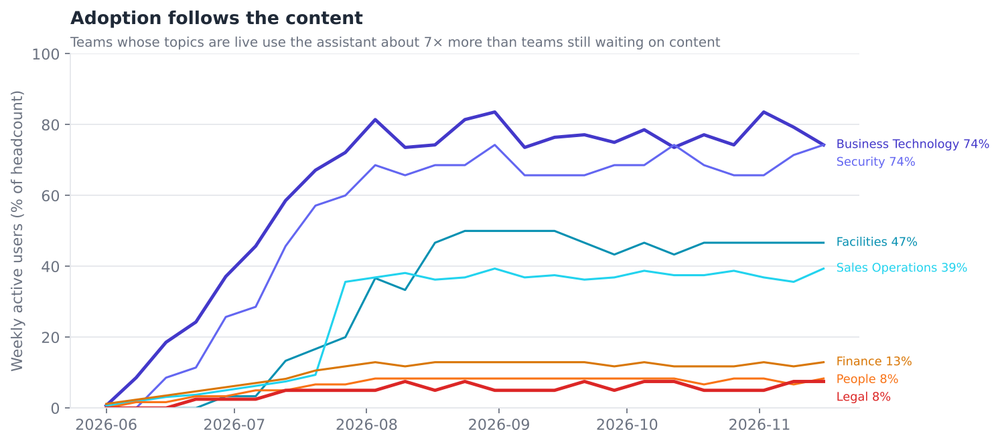
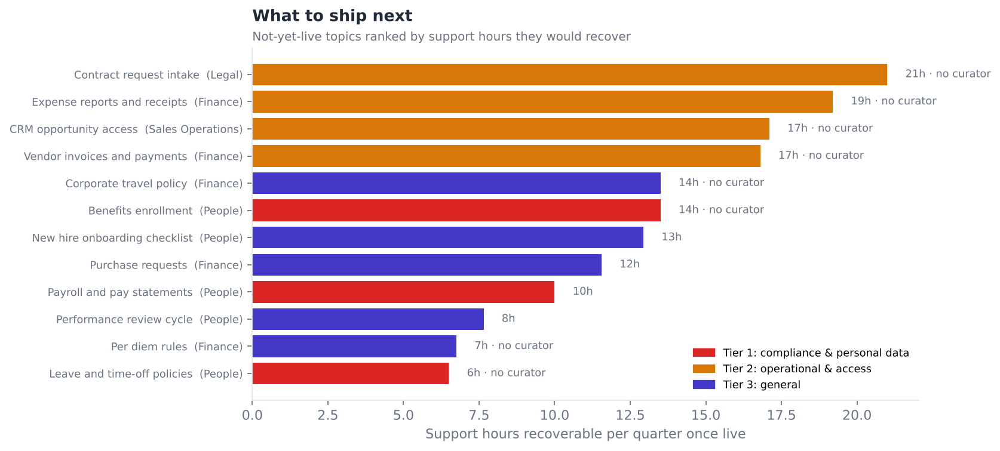
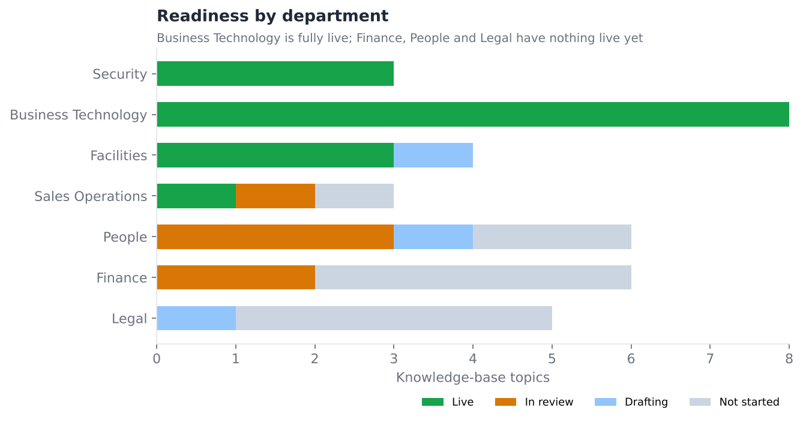
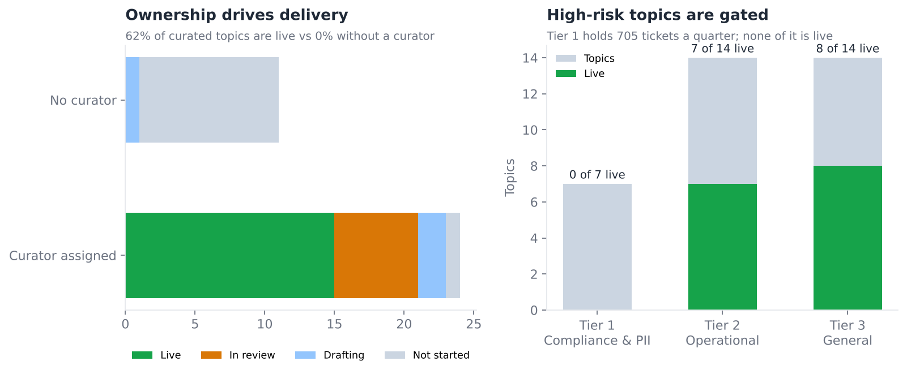

# AI Adoption & Enablement

**How to scale an internal AI assistant responsibly: track who uses it, which knowledge it can answer from, what support demand it absorbs, and which high-risk topics need governance before they go live.**

### ▶ [Open the live demo](https://k-b-c-04.github.io/ai-adoption-enablement/) · 📄 [Read the strategy brief](STRATEGY_BRIEF.md)

> **All data is synthetic.** *Wazobia Corp* is a fictional company and *Ask Wazobia* its fictional assistant. Every topic, ticket, person and figure is generated by [`data/generate_data.py`](data/generate_data.py). The original dashboard was built in Google Sheets to support a real knowledge-base rollout; this repo recreates it without any company or employee data.



---

## The problem

Rolling out an AI assistant is not a launch; it is a content and governance program. The assistant is only as useful as the knowledge it can answer from, and some of that knowledge (payroll, benefits, legal holds, privacy requests) carries real compliance risk. Leadership needs answers to four questions:

1. **Adoption:** who is using it, and is usage growing?
2. **Value:** how much support demand does it absorb today, and how much is still unaddressed?
3. **Priorities:** which topics should be built next, and in what order?
4. **Risk:** which high-risk topics are blocked, and what is holding them back?

This project brings usage, the knowledge-base topic register, governance controls, and the support tickets behind each topic into one view.

## What it found (synthetic data)

| | Finding | Recommended action |
|---|---|---|
| **Adoption** | **41%** of employees use the assistant weekly. Teams with live content are at **74%**; Finance, People and Legal are at **~10%**. | Launch to each team when its content goes live |
| **Value** | **15 of 35** topics are live, covering **51%** of support demand and recovering about **246 support hours a quarter**. **73%** of questions are resolved without a ticket. | Expand coverage; quality is already high (**90%** rated helpful) |
| **Ownership** | **62%** of topics with a curator are live, versus **0%** without one. 11 unowned topics hold ~130 hours a quarter. | Assign a curator to every topic first |
| **Risk** | All **7** Tier 1 (compliance and personal data) topics are blocked, with **20** governance controls open and **705** tickets a quarter waiting. | A dedicated Tier 1 review lane with fixed required controls |

The sequencing, owners and success measures are in the **[strategy brief](STRATEGY_BRIEF.md)**.







## The demo

| View | What it does |
|---|---|
| **Executive summary** | Headline KPIs, the four decisions above, weekly adoption by department, and support hours recovered vs still available |
| **Adoption** | Weekly active users, questions resolved vs escalated, and a department scorecard; filter by department |
| **Enablement & governance** | Enablement status, risk tiers and department readiness (select a bar or row to filter); department rollout and owners; risk-tier breakdown with open controls; a topic register ranked by hours recoverable; an intake form for new topics |
| **Ticket evidence** | The support tickets that justify each topic, searchable by keyword and department |

## The operating model behind it

- **Risk tiers set the bar for going live.** Tier 3 (general) needs an answer-accuracy test. Tier 2 (operational and access) adds an escalation path and an access-control check. Tier 1 (compliance and personal data) adds PII review and legal approval.
- **Every topic has a curator.** A named owner in the business keeps the content accurate and signs off on changes.
- **Topics are justified by evidence.** Each topic links to the real support tickets it would absorb, so prioritization is driven by demand rather than opinion.
- **Value is measured in support hours.** Tickets per quarter × the share the assistant can resolve (by tier) × average handle time.

## Repository contents

| Path | What it is |
|---|---|
| [`docs/index.html`](docs/index.html) | The interactive demo: one self-contained page (HTML, CSS, JavaScript and Chart.js), served by GitHub Pages |
| [`analysis/analyze.py`](analysis/analyze.py) | The analysis behind the brief: adoption, coverage, ownership, risk gating and the prioritized backlog; renders the charts |
| [`data/generate_data.py`](data/generate_data.py) | Generates the fictional company's datasets |
| [`data/*.csv`](data/) | 35 knowledge-base topics, 70 example tickets, 25 weeks of usage across 7 departments, and the governance controls per topic |
| [`STRATEGY_BRIEF.md`](STRATEGY_BRIEF.md) | One-page leadership brief: findings, recommendations, owners, measures |

**Run it locally**
```bash
pip install pandas matplotlib numpy
cd data && python generate_data.py && cd ..   # regenerate the data (optional)
python analysis/analyze.py                     # print findings, write charts to images/
python -m http.server -d docs 8000             # open http://localhost:8000
```

---

*Part of [Kamsi's portfolio](https://github.com/K-B-C-04).*
